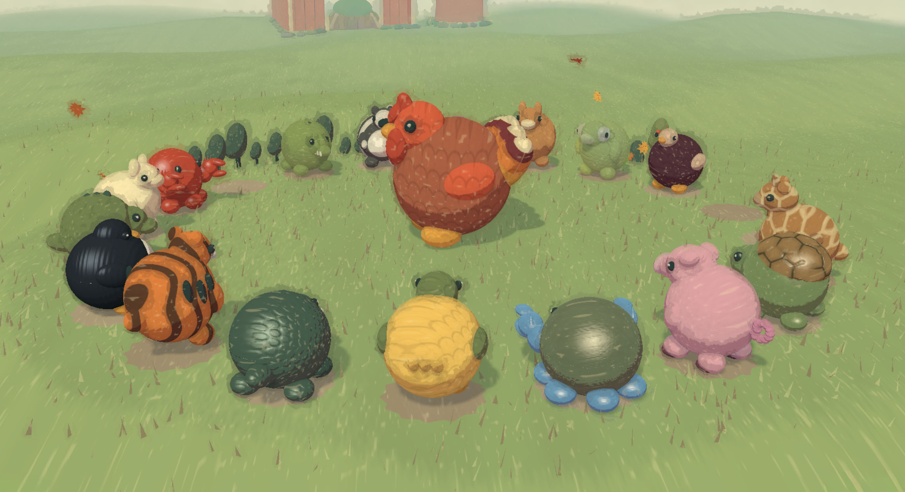

# What the STUFF!? 🦃



**The best part of Thanksgiving is the stuffing!** 🍂

[Play What the STUFF!?](https://what-the-stuff.com/) and build wonderfully ridiculous animal combinations, one nesting doll at a time.

## How to play 🎯

A combination name is your clue. Pick its three animals in order and watch them hop inside one another. **Turducken**, for example, starts with Turkey, followed by Duck and Chicken.

- Play five combinations and earn a point for each one you solve on the first try.
- Drag upward on the animal in the middle to open the nest; let go to watch it settle back together.
- Drag around the scene to orbit, and scroll or pinch to zoom.
- Share your finished score and time when the flock is stuffed!

## Free Play 🐷🦀🐊

Choose **Free Play** to nest animals in any order and invent your own creations. Make a Crabigator, peek inside your nest, and share a link that opens your exact combination. Use **Start over** to send everyone back to their spots.

## Run it locally 🛠️

```bash
npm install
npm start
```

Open the local URL printed by Vite. To create a production build, run `npm run build`; use `npm run preview` to preview it.

Built with React, Three.js, and React Three Fiber, with a watercolor finish and a little Thanksgiving spirit. 🍁
